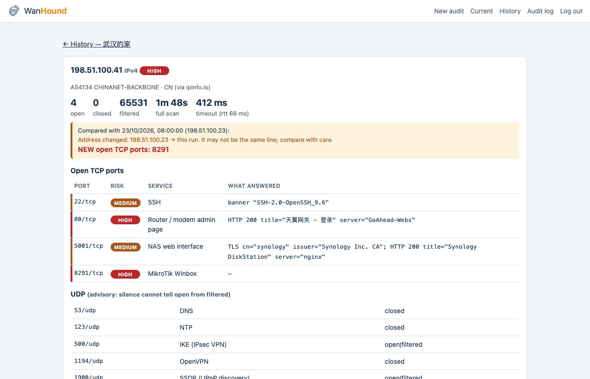
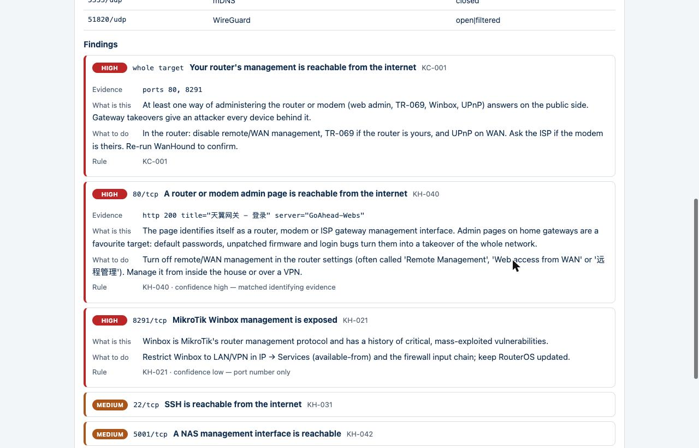
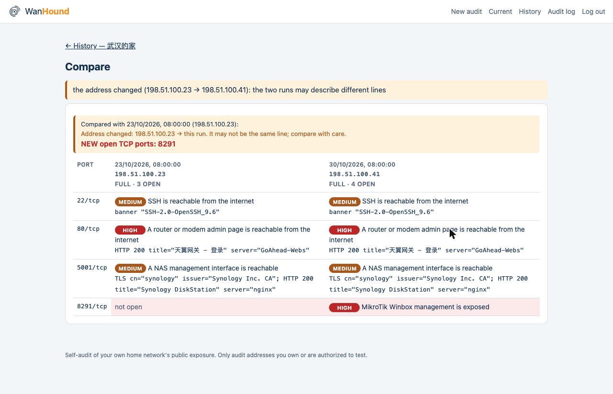
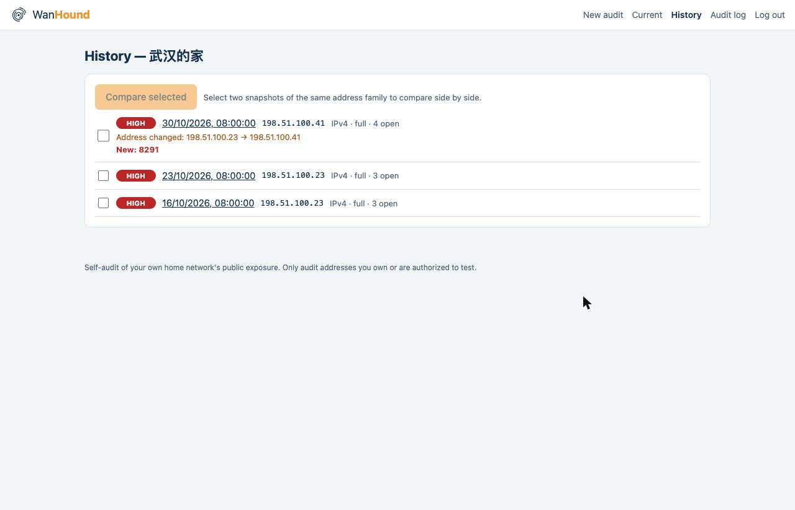
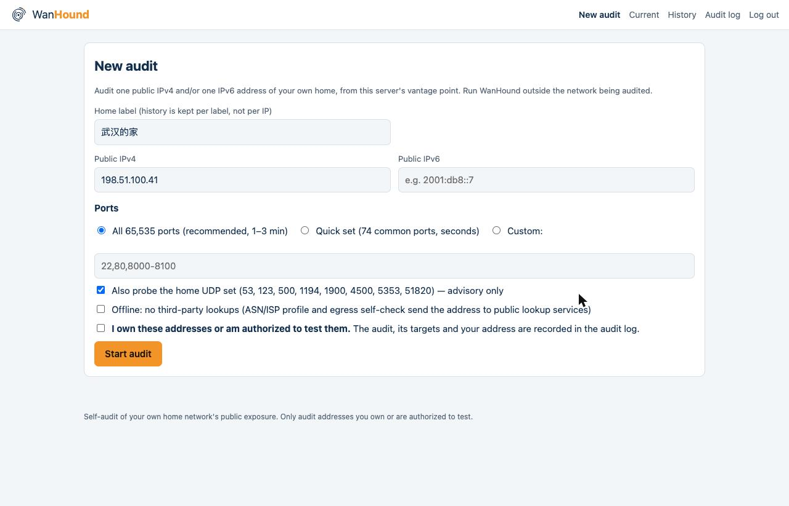

<p align="center">
  
</p>

<h1 align="center">WanHound</h1>

<p align="center"><strong>Audit your own home network's public exposure — from the outside.</strong></p>

<p align="center">English · <a href="README.zh-CN.md">简体中文</a></p>

<p align="center">
Give WanHound your home's public IPv4 or IPv6 address. It probes every port from an external vantage point, identifies what answers, explains the risk in plain language, and diffs the result against last time.
</p>

---

Your router's admin page, your NAS login, a database a container quietly published, a port some device opened for itself via UPnP — from inside the house, none of this is visible. WanHound stands outside and knocks on every door, then writes you a readable report instead of raw scan output.

WanHound is the outside companion to [LanHound](https://github.com/playwjj/lanhound), which watches devices *inside* the LAN. LanHound sees who is home; WanHound checks which doors face the street.

<p align="center">
  
</p>

## What it does

- **Full-port TCP audit** of a single IPv4 and/or IPv6 address (all 65,535 ports by default; a curated `--quick` set for fast re-checks; `--ports` for your own list). UPnP mappings and device services love random high ports, so the default does not stop at the top 1000.
- **Adaptive, conservative pacing** — a short RTT calibration picks the per-connection timeout (a silent gateway does not stretch the audit), a pacer caps the connection rate, and scattered filtered ports get one slower retry pass. A full audit typically takes 1–3 minutes, and the expected worst case is printed before it starts.
- **Three-state results** — `open` / `closed` / `filtered` are reported separately; silence is never dressed up as "safe".
- **Service identification** — banner grab, TLS certificate (issuer, expiry, self-signed), HTTP status/server/title over plain HTTP *and* TLS (following one same-origin redirect), so a finding says *what* answered, with the evidence attached and a confidence level.
- **Plain-language risk findings** from a structured, versioned rule base (60+ entries): every rule is `match (port / banner / title / server / certificate / auth patterns) → risk, explanation, advice, rule ID`. Router and modem admin pages, cameras, NAS panels, hypervisor/container panels, databases, remote desktops, Telnet, TR-069, Winbox, SMB… `wanhound rules` lists them all.
- **Whole-home combination rules** — router management reachable from the internet, databases/remote desktops published directly, "ten ports open: a DMZ host?", IPv6 hits with no NAT in front, smart-home devices on the street.
- **Small UDP set** (DNS — including open-resolver detection —, NTP, IKE, OpenVPN, SSDP/UPnP, mDNS, WireGuard), clearly marked advisory.
- **Snapshot diff** — history is kept per *home label* (not per IP, because home addresses change), address changes are reported as events, and the next run calls out **newly opened ports** at the top. Diffs are coverage-aware: a `--quick` re-check never "closes" the high ports a full audit found.
- **Vantage-point self-checks before scanning** — private, loopback, CGNAT (`100.64.0.0/10`) and reserved addresses are refused with an explanation; if this machine's public egress *is* the target, or a transparent proxy / TUN-mode VPN is answering for every port, WanHound stops and tells you why instead of producing a distorted report.
- **English or Chinese reports** — terminal, HTML, Web UI and push digest (`--lang zh`, or automatically under a `zh_*` locale).
- **LanHound companion mode** — audit every device's public IPv6, one by one, from a LanHound device export.
- **CLI + Web UI, one binary** — `wanhound scan` for scripts and cron (exit-code contract, JSON, standalone HTML report, optional Telegram push), `wanhound serve` for a password-gated web interface with live progress, history timeline and side-by-side diff.

## How it differs

| | What it answers | How |
|---|---|---|
| IP lookup sites | "Whose address is this?" | Registry data. Never touches the target. |
| Shodan / Censys | "What did a crawler see, days ago?" | A third-party historical database; home IPs are often stale or missing, IPv6 coverage is thin. |
| nmap | "Which ports are open?" | Raw data for experts — an X-ray, not a diagnosis. |
| **WanHound** | "**What of mine is exposed right now, how bad is it, and what changed?**" | Live probing + a home-focused rule base + history diff. A checkup report. |

## Safety & scope — read this first

WanHound is a **defensive self-audit tool**, in the same family as nmap or Greenbone, and it is deliberately fenced:

- **One target at a time.** A single IPv4 and/or IPv6 literal. No CIDR ranges, no target lists — single-target audit vs. bulk scanning is the line this project does not cross.
- **Probe only, never exploit.** Plain TCP `connect()` plus read-only banner/TLS/HTTP identification. No vulnerability checks, no password guessing, no payloads, no stealth/evasion features, conservative default rates.
- **Audit only addresses you own or are authorized to test.** The intended use is: run it on an outside machine (a VPS, a friend's network) against *your own* home address.
- **The Web UI is always password-gated.** A reachable scanner page turns your server into someone else's jump host and the abuse lands on *your* IP — so `serve` refuses to run without a password, and the docs recommend binding it to a LAN/Tailscale address.

## Quick start

Download a binary from [Releases](https://github.com/playwjj/wanhound/releases) (Linux, macOS, Windows), or build from source (Go 1.25+, no other dependencies — pure standard library, one static binary):

```bash
git clone https://github.com/playwjj/wanhound.git
cd wanhound
make build
```

Or Docker (published image — or `docker build -t wanhound .` and use that tag instead):

```bash
# Full-port audit of both stacks, saved under the label "home"
docker run --rm -v wanhound-data:/home/wanhound/.local/share/wanhound \
  passport888/wanhound scan --ipv4 <your-public-ip> --ipv6 <your-public-ipv6> --label home

# Fast re-check on the curated port set
docker run --rm -v wanhound-data:/home/wanhound/.local/share/wanhound \
  passport888/wanhound scan --ipv4 <your-public-ip> --label home --quick

# Web UI (always password-gated — see Safety & scope)
docker run -d --name wanhound -p 127.0.0.1:8687:8687 \
  -e WANHOUND_PASSWORD='<choose-a-strong-password>' \
  -v wanhound-data:/home/wanhound/.local/share/wanhound \
  passport888/wanhound serve --addr 0.0.0.0:8687
```

The named volume keeps your snapshots, so the next run can diff against the last one (without it, `--rm` throws the history away). Mount it at exactly `/home/wanhound/.local/share/wanhound`: the container runs as a non-root user and keeps its data there, so mounting the volume at another path (for example `/data`) fails with a permission error.

Run a scan **from outside your home network**, using the WAN address your router shows (placeholders below — documentation addresses such as `198.51.100.x` are refused as reserved):

```bash
# Full audit of both stacks, saved under the label "home"
./wanhound scan --ipv4 <home-ipv4> --ipv6 <home-ipv6> --label home

# Fast re-check on the curated port set
./wanhound scan --ipv4 <home-ipv4> --label home --quick

# Just a few ports (add --udp for the UDP set)
./wanhound scan --ipv4 <home-ipv4> --ports 22,80,443,8291

# History and stored reports
./wanhound history                       # labels
./wanhound history --label home          # timeline: address changes, new/closed ports
./wanhound show --label home --html report.html

# Housekeeping
./wanhound delete --label home --keep 10     # keep the newest 10 per address family
./wanhound delete --label home --id <snapshot-id>
```

Example output (abridged):

```
━━ 198.51.100.23 (IPv4) ━━
AS4134 CHINANET-BACKBONE · CN  (via ipinfo.io — the address was shown to that service)
Scanned 65535 TCP ports in 1m42s (timeout 412ms, rtt 66ms): 3 open · 0 closed · 65532 filtered
Compared with 2026-10-23 09:00 (198.51.100.23):
  NEW open TCP ports: 8291

  PORT       SERVICE                    RISK    FINDING
  80/tcp     Router / modem admin page  HIGH    A router or modem admin page is reachable from the internet
  8291/tcp   MikroTik Winbox            HIGH    MikroTik Winbox management is exposed
  51413/tcp  unknown                    LOW     Port 51413 is open and not in the known-service list

Findings (worst first):

[HIGH] whole target  Your router's management is reachable from the internet  (KC-001)
    evidence  ports 80, 8291
    what      At least one way of administering the router or modem … answers on the public side.
    do        In the router: disable remote/WAN management, TR-069 if the router is yours, and UPnP on WAN. …

[HIGH] 80/tcp  A router or modem admin page is reachable from the internet  (KH-040, confidence high — matched identifying evidence)
    evidence  http 200 title="天翼网关" server="GoAhead-Webs"
    …
```

Notes on the report:

- On an IPv4 target, an open port may be the router's own service **or** a forward/UPnP mapping to an inside device — from outside these cannot always be told apart, and the report says so rather than guessing. On IPv6 there is no NAT: a hit is the device itself.
- `filtered` means *this vantage point* got silence. Important results deserve a re-check from a second network.
- Every finding cites its rule ID (`KH-*` per port, `KU-*` UDP, `KC-*` whole target) and its confidence: *high* = identifying evidence matched (banner, title, certificate), *medium* = protocol recognized, *low* = port number only.
- The report ends with an audit record: time, scanner egress address, target, port set, duration, rule-base version, snapshot ID.

### Exit codes (for cron / alerting)

| Code | Meaning |
|---|---|
| 0 | No high-risk findings, nothing new |
| 1 | A high-risk finding, **or** ports newly opened since the last snapshot |
| 2 | The audit could not run (bad input, unauditable address, distorted vantage point) |

```bash
# crontab: daily quick check, Telegram push only when the exit code is 1
0 7 * * * WANHOUND_TELEGRAM_TOKEN=… WANHOUND_TELEGRAM_CHAT=… wanhound scan --ipv4 <home-ipv4> --label home --quick
```

`--json` prints the full machine-readable audit; `--html report.html` writes a standalone one-page report (inline CSS, readable on a phone — good for showing the family).

### Useful flags

| Flag | Default | |
|---|---|---|
| `--label` | `home` | History key. Use a name per home ("武汉的家" is fine). |
| `--quick` / `--ports` | full | Port set. |
| `--no-udp` / `--udp` | UDP on for full/quick | UDP set. |
| `--offline` | off | No third-party lookups at all (ASN/PTR profile, egress self-check). |
| `--timeout` | adaptive | Per-connection timeout in ms. |
| `--concurrency` / `--rate` | 512 / 2000 per s | Hard-capped at 2048 / 10000. |
| `--yes` | off | Continue when the vantage-point check objects. |
| `--data-dir` | `~/.local/share/wanhound` | Or `WANHOUND_DATA`. |
| `--lang` | from locale | Report language: `en` / `zh` (or `WANHOUND_LANG`; a `zh_*` locale picks Chinese). |

### Accepted risks: alert only on what is new

Some findings you cannot fix right away — an ISP modem whose settings you cannot change, say. Record them as accepted, with a reason and an expiry, so scheduled audits stay quiet about them and alert only on new problems:

```bash
./wanhound accept --label home --rule KU-001 --port 53 --reason "ISP modem DNS; bridge mode planned" --days 90
./wanhound accept --list
./wanhound accept --remove <id>
```

- An accepted finding stays in every report, marked as accepted with its reason, but no longer counts towards the worst risk, the exit code or Telegram alerts — and no longer feeds the whole-target combination rules.
- Acceptances are per label, rule and port, and expire (at most a year): after that the finding alerts again and the report says the acceptance lapsed.
- Newly opened ports always alert.
- In the Web UI every finding has an "Accept this risk…" button; the *Accepted risks* page lists and removes them. Every decision is audit-logged.

### With LanHound: every device's IPv6, one by one

IPv6 has no NAT: each device at home has its own public address, and those addresses are only visible from inside the LAN. Hand WanHound the device table exported by [LanHound](https://github.com/playwjj/lanhound) (the CSV export of its device list, `/api/devices.csv`) and it audits each device's public IPv6 address **one at a time** — still single-target audits, never a range scan:

```bash
./wanhound scan-lanhound --csv lanhound-devices.csv --label home --dry-run   # list the targets
./wanhound scan-lanhound --csv lanhound-devices.csv --label home --quick     # confirm, then audit each
```

- By default only the address LanHound saw most recently is used per device; `--all-addresses` takes them all. ULA and link-local addresses are skipped.
- Each device gets its own history label (`home · <device>`), so every device has its own diff.
- The target list is shown and must be confirmed (`--yes` for non-interactive runs); more targets than `--max` (default 32) are refused.
- IPv6 privacy (temporary) addresses rotate; an address seen a while ago may be gone.
- The Web UI does the same: load `devices.csv` at the bottom of the New audit page, tick devices, and they are audited one after another with a per-device summary at the end.

### Web UI

```bash
# Store a hash rather than the plaintext (or set WANHOUND_PASSWORD directly)
export WANHOUND_PASSWORD_HASH=$(echo 'choose-a-strong-one' | ./wanhound hash-password 2>/dev/null)
./wanhound serve --addr 127.0.0.1:8687
# or bind your Tailscale address — avoid public exposure even with a password
```

New audit form → live progress (cancellable) → report page with risk-colored port table and expandable "what is this / what to do" cards → per-label history timeline (address-change events, new/closed ports) → pick any two snapshots for a side-by-side diff → download any snapshot as a standalone HTML report.

<table>
  <tr>
    <td width="50%"><br><sub>Every finding: evidence, what it is, what to do, rule ID and confidence.</sub></td>
    <td width="50%"><br><sub>Side-by-side diff of any two snapshots — new ports in red, address changes flagged.</sub></td>
  </tr>
  <tr>
    <td width="50%"><br><sub>History per home label, not per IP.</sub></td>
    <td width="50%"><br><sub>New audit: one IPv4 and/or one IPv6, with an explicit authorization assertion.</sub></td>
  </tr>
</table>

<sub>Screenshots show demo data (documentation addresses).</sub>

The gate is not optional:

- `serve` will not start without a password (min. 10 characters); it is kept only as a PBKDF2-SHA256 hash. Sessions are HttpOnly, SameSite=Strict cookies; state-changing calls need a custom header (no cross-site forms).
- Failed logins are slowed and throttled (5 per address and 30 globally per 15 minutes).
- Each audit must be submitted with an explicit *"I own these addresses or am authorized to test them"* assertion and is written to an append-only `audit.log` (target, client address, user agent, time, outcome), viewable in the UI.
- One audit at a time, a global cap (`--scans-per-hour`, default 6), and engine limits the browser cannot change.
- Snapshots and whole labels can be deleted from the history page (two-step confirmation, audit-logged); `audit.log` rotates to `audit.log.1` past 5 MB.
- Behind a reverse proxy every client shares the proxy's address for throttling; `X-Forwarded-For` is recorded in the audit log but never trusted.

## How it works

```
address ──▶ classify (public? CGNAT? private?) ──▶ connect-scan (3-state)
        ──▶ probe open ports (banner / TLS / HTTP) ──▶ rule base (findings)
        ──▶ snapshot under your home label ──▶ diff vs. last run ──▶ report
```

- Pure Go standard library: no cgo, no embedded nmap, no raw sockets (so no `NET_RAW`, no root).
- Address intel (ASN/ISP via ipinfo.io — set `WANHOUND_IPINFO_TOKEN` to use a token — falling back to ip.sb) and the egress self-check (ipify / ifconfig.co / icanhazip) are the only outbound requests besides the probes themselves, and `--offline` disables them all — note that any online lookup necessarily shows the queried address to that service.
- Snapshots live in `~/.local/share/wanhound/labels/<label>/` as plain JSON, one file per run.
- Package layout: `cmd/wanhound` (CLI) · `internal/audit` (the pipeline shared by CLI and web) · `internal/intel` (address classes, ASN/PTR profile, egress) · `internal/scan` (TCP engine + UDP set) · `internal/probe` (banner/TLS/HTTP) · `internal/knowledge` (rule base, `rules.json`) · `internal/store` (snapshots/diff) · `internal/report` (terminal, summary, HTML) · `internal/web` (serve mode + embedded UI).

## Roadmap

- **P0 — done** — dual-stack single-target audit with address classification (CGNAT/private/reserved refusal), full/quick/custom port sets, adaptive timeouts, three-state engine, banner probing, structured rule base, terminal + JSON output, exit-code contract.
- **P1 — done** — TLS/HTTP deep identification, combination rules, per-label snapshot diff, vantage-point self-checks, UDP probe set, Web UI with progress, report, history timeline and side-by-side diff, plus the full access-control set.
- **P2 — done** — standalone HTML report export ✔, Telegram push ✔, auditing each device's IPv6 from a LanHound export ✔ (one by one — still no range scanning).
- **v0.3** — Simplified Chinese reports (terminal, HTML, Web UI, Telegram digest).
- **v0.5** — accepted risks (reason + expiry; quiet until they lapse); clearer egress status; SNI-only TLS ports recognized as HTTPS.
- **v0.4** — LanHound batch import in the Web UI; snapshot/label deletion and `audit.log` rotation; macOS and Windows binaries; ipinfo token.

## Known limitations

- **The vantage point decides the result.** Different outside networks filter differently; `filtered` is not proof of safety.
- **Proxies and VPNs on the scanning machine.** A TUN-mode proxy (Clash, Surge…) answers every connection itself; WanHound detects the "everything is open" pattern and refuses, but a split-tunnel setup can still route some probes through a proxy. Run from a clean machine.
- **Dynamic IPs.** History is keyed by label, but if your address changed, old and new runs may describe different lines — the report flags address changes.
- **Shared exits.** On carrier-grade NAT, an "what is my IP" site shows an exit shared with other customers. WanHound refuses `100.64.0.0/10` and hints when the ISP profile looks like a mobile/CGNAT operator, but cannot prove which address is yours — use the WAN address shown by your router.
- **ICMP rejects read as closed on Linux.** When a firewall rejects with ICMP *port unreachable*, Linux reports it to `connect()` exactly like a TCP reset, so the port shows as `closed` (which, for exposure, it is). Other ICMP rejects such as admin-prohibited show as `filtered`.
- **UDP is fuzzy.** No response cannot distinguish open from filtered; UDP findings are advisory.
- **Identification is fingerprinting.** Banners and titles are evidence, not proof; findings show their evidence and a confidence level.
- **IPv6 scope = the addresses you give it.** IPv6 space cannot be enumerated; devices you don't list are not audited.

## Development

```bash
make build     # ./wanhound (Go 1.25+, standard library only)
make test      # unit + integration tests (engine, rules, store/diff, audit pipeline, web access control)
make vet
make testbed   # acceptance bench on a Linux Docker host (see below; CI runs it on every push)
# CI also runs the full test suite on Windows and macOS (socket error semantics differ per OS)
```

**Test bench.** `scripts/testbed.sh <linux-binary>` starts a container whose ports have known states — listeners (`open`), a TCP-reset reject and an unused port (`closed`), an iptables `DROP` and an ICMP admin-prohibited reject (`filtered`), a UDP open resolver, a dropped and a closed UDP port — audits it with `wanhound scan --lab`, asserts every state, rule hit and UDP result, then opens one more port and asserts the diff and exit code 1. The firewall rules live inside the container's network namespace; the host firewall is untouched. `--lab` (CLI and `serve`) permits private/loopback targets for exactly this purpose; CGNAT and reserved ranges stay refused.

The rule base is `internal/knowledge/rules.json`, with Chinese texts in `rules.zh.json` keyed by rule ID (a test fails if any rule lacks a translation); other user-facing text lives in `internal/i18n/catalog.go`. Bump `version` when editing rules, keep specific evidence rules before port-number fallbacks within a `group`, and run `make test` — the loader rejects duplicate IDs, bad regexes and rules without conditions.

## License

MIT — see [LICENSE](LICENSE).

Only audit networks you own or are authorized to test.
