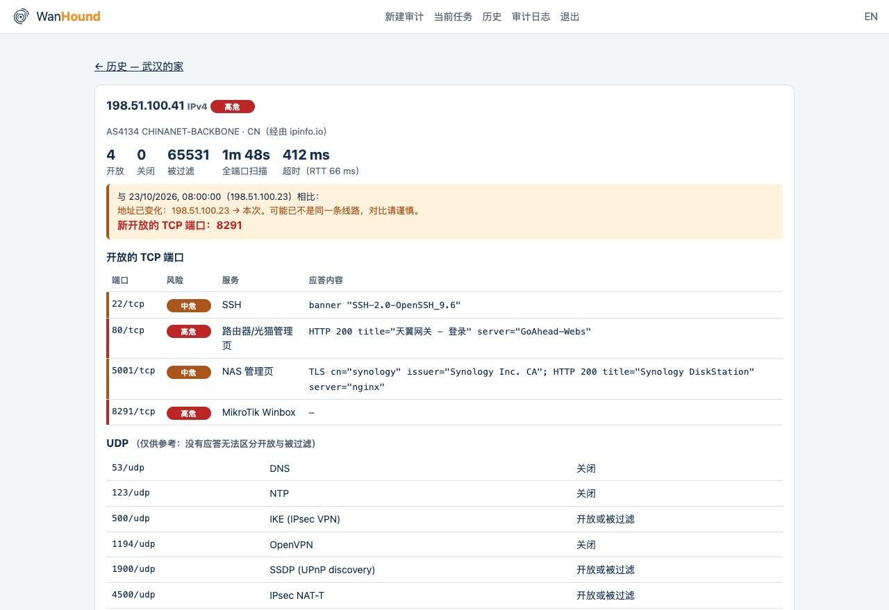
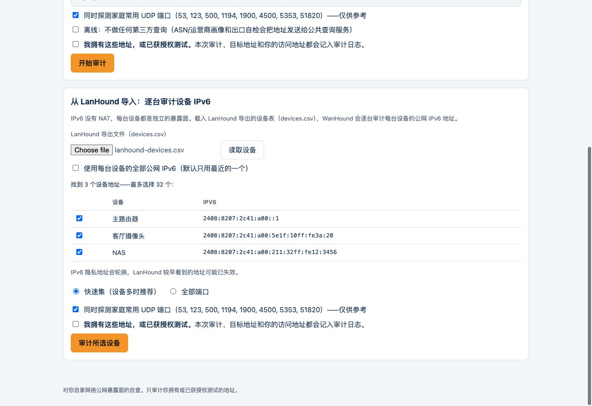
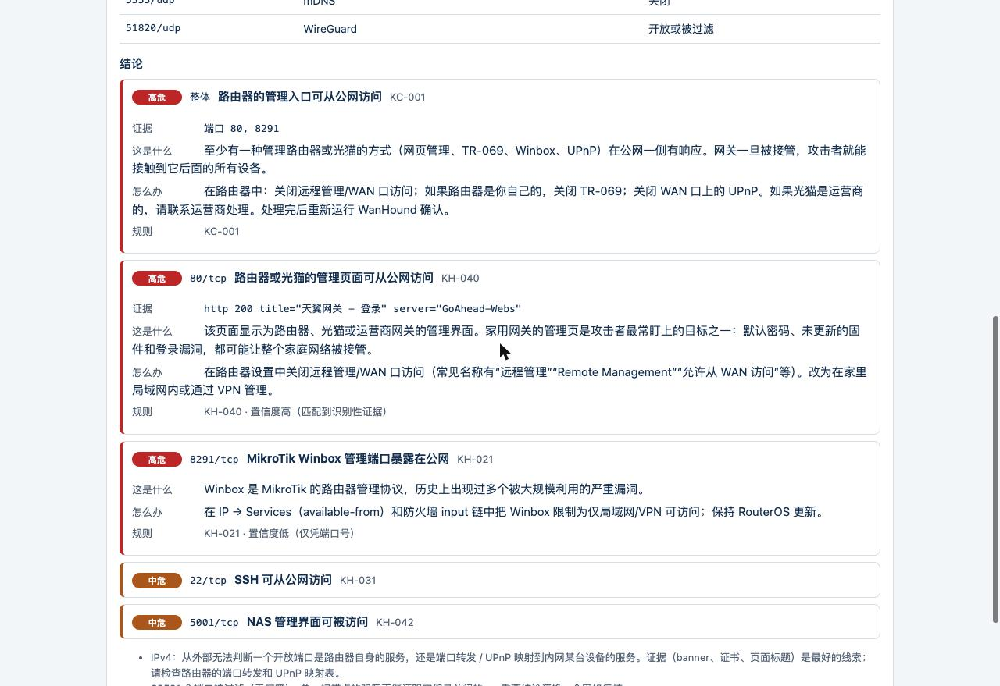
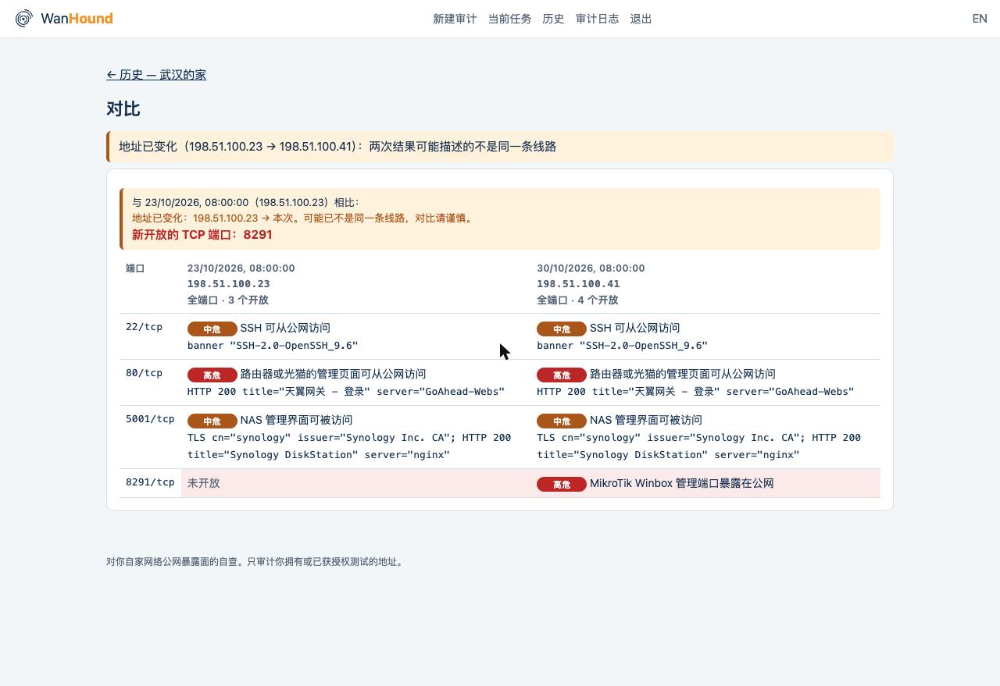
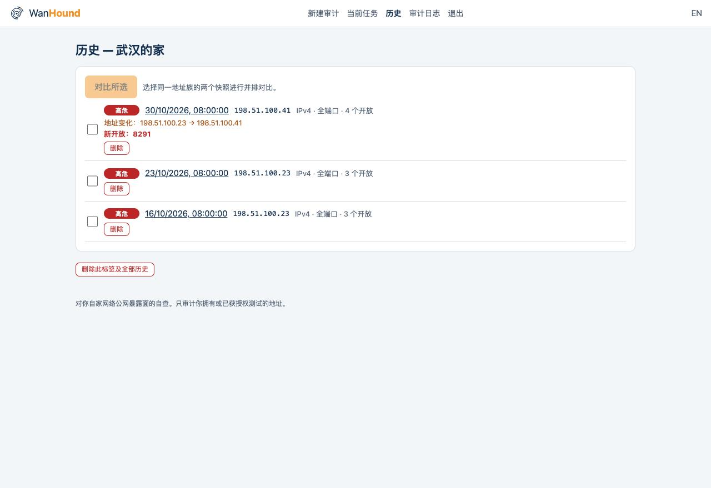
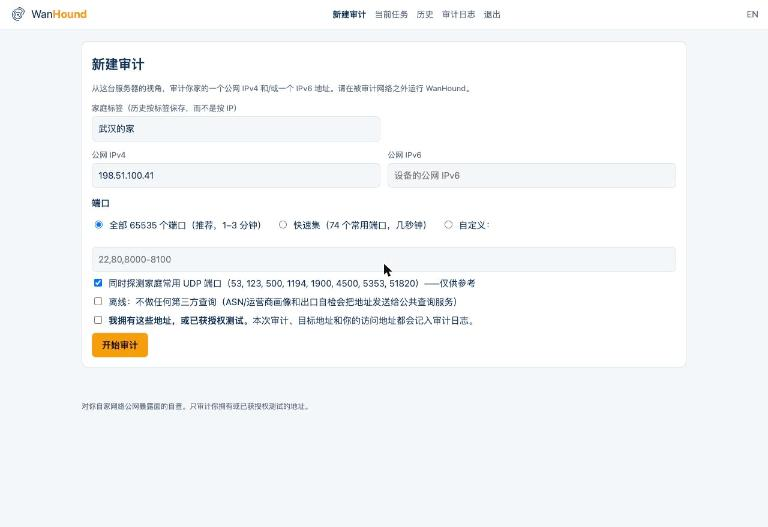

<p align="center">
  
</p>

<h1 align="center">WanHound</h1>

<p align="center"><strong>站在门外，体检你家的公网暴露面。</strong></p>

<p align="center"><a href="README.md">English</a> · 简体中文</p>

<p align="center">
把你家的公网 IPv4 或 IPv6 地址交给 WanHound：它从外部视角逐个敲门（全端口），识别门后是什么服务，用人话讲清楚风险和处置办法，并和上一次的结果对比。
</p>

---

路由器的管理页、NAS 的登录页、某个容器悄悄发布出去的数据库、某台设备自己通过 UPnP 打开的端口——这些从家里面都看不见。WanHound 站在门外把每扇门都敲一遍，然后给你一份看得懂的体检报告，而不是一堆原始扫描数据。

WanHound 是 [LanHound](https://github.com/playwjj/lanhound) 的"外侧"姊妹工具：LanHound 在局域网**里面**看有哪些设备，WanHound 在外面看哪些门朝着大街开。

<p align="center">
  
</p>

## 能做什么

- **全端口 TCP 审计**：针对单个 IPv4 和/或单个 IPv6 地址，默认扫描全部 65535 个端口；`--quick` 用精选常用端口集快速复检；`--ports` 自定义端口。UPnP 自动映射和设备服务最爱落在随机高位端口，所以默认不止扫 top-1000。
- **自适应、克制的速率**：扫描前先测 RTT 基线来确定单端口超时（沉默型网关不会把扫描拖长），限速器封顶连接速率，零散的 filtered 端口会以更长超时再试一轮。全端口审计一般 1–3 分钟，开始前会打印最坏情况的预计耗时。
- **三态结果**：`open` / `closed` / `filtered` 分开报告，绝不把"没回应"包装成"安全"。
- **服务识别**：banner 抓取、TLS 证书（签发者、有效期、是否自签）、明文 HTTP **和** HTTPS 的状态码 / Server 头 / 页面标题（会跟随一次同源跳转），所以每条结论都说明"是谁在应答"，附上证据和置信度。
- **人话风险结论**：来自结构化、带版本号的规则库（60+ 条）。每条规则的形式都是 `匹配条件（端口 / banner / 标题 / Server / 证书 / 认证提示）→ 风险等级、说明、建议、规则编号`。覆盖路由器/光猫管理页、摄像头、NAS、虚拟化/容器面板、数据库、远程桌面、Telnet、TR-069、Winbox、SMB 等；`wanhound rules` 可列出全部规则。
- **整户组合规则**：路由器管理入口暴露在公网、数据库/远程桌面直接对外发布、"开了十几个端口：是不是设了 DMZ 主机？"、IPv6 命中（没有 NAT 掩护）、智能家居设备暴露。
- **UDP 小集**（DNS——含开放解析器检测、NTP、IKE、OpenVPN、SSDP/UPnP、mDNS、WireGuard），明确标注仅供参考。
- **快照对比**：历史按**家庭标签**保存（不按 IP，因为家宽地址会变），地址变化记为事件，下一次运行会把**新开放的端口**放在报告最前面。对比会考虑扫描覆盖范围：全端口审计之后用 `--quick` 复检，不会把高位端口误报为"已关闭"。
- **扫描前的位置自检**：私网、回环、CGNAT（`100.64.0.0/10`）和保留地址会被拒绝并说明原因；如果本机的公网出口**就是**目标地址，或者本机的透明代理 / TUN 模式 VPN 在替所有端口应答，WanHound 会停下来说明原因，而不是给出一份失真的报告。
- **中文 / 英文报告**：终端、HTML、Web 界面和推送摘要都支持中文。
- **配合 LanHound**：读取 LanHound 导出的设备表，逐个审计每台设备的公网 IPv6。
- **CLI + Web UI，同一个二进制**：`wanhound scan` 供脚本和 cron 使用（退出码约定、JSON、独立 HTML 报告、可选 Telegram 推送）；`wanhound serve` 提供口令保护的网页界面，带实时进度、历史时间线和并排对比。

## 和其他工具的区别

| | 回答的问题 | 方式 |
|---|---|---|
| IP 查询网站 | "这个地址是谁的？" | 注册库数据，不碰目标。 |
| Shodan / Censys | "爬虫几天前看到了什么？" | 第三方历史数据库；家宽 IP 记录常常过期或缺失，IPv6 覆盖很薄。 |
| nmap | "哪些端口开着？" | 给专家看的原始数据——是 X 光片，不是诊断。 |
| **WanHound** | "**我家现在有什么暴露在外、有多严重、和上次比有什么变化？**" | 实时探测 + 面向家庭的规则库 + 历史对比。一份体检报告。 |

## 安全与边界——请先读这里

WanHound 是一个**防御性的自查工具**，和 nmap、Greenbone 同类，并且刻意设了围栏：

- **一次只审计一个目标**：一个 IPv4 和/或一个 IPv6 地址。不支持网段、不支持目标列表——单目标审计与批量扫描之间的这条线，本项目不会跨过。
- **只探测，不利用**：普通的 TCP `connect()` 加只读的 banner/TLS/HTTP 识别。不做漏洞验证、不猜口令、不发攻击载荷、没有隐蔽/绕过检测功能，默认速率保守。
- **只审计你拥有或已获授权测试的地址**。推荐用法：在一台外部机器（VPS、朋友家的网络）上，扫描**你自己家**的地址。
- **Web UI 一律需要口令**：一个能被访问到的扫描页面，会让你的服务器变成别人的跳板，投诉最终落在**你的** IP 上——所以 `serve` 没有口令就拒绝启动，文档也建议只绑定局域网 / Tailscale 地址。

## 快速开始

下载 [Releases](https://github.com/playwjj/wanhound/releases) 中的二进制（Linux、macOS、Windows），或从源码构建（Go 1.25+，无其他依赖——纯标准库，单个静态二进制）：

```bash
git clone https://github.com/playwjj/wanhound.git
cd wanhound
make build
```

或者用 Docker：

```bash
docker run --rm -v wanhound-data:/home/wanhound/.local/share/wanhound \
  ghcr.io/playwjj/wanhound scan --ipv4 <家里的IPv4> --label home
```

**在家庭网络之外**运行扫描，地址用路由器 WAN 口显示的公网地址（下面是占位符；`198.51.100.x` 这类文档示例地址属于保留段，会被拒绝）：

```bash
# 同时审计双栈，结果存到标签 "home" 下
./wanhound scan --ipv4 <家里的IPv4> --ipv6 <家里的IPv6> --label home

# 用精选端口集快速复检
./wanhound scan --ipv4 <家里的IPv4> --label home --quick

# 只扫几个端口（加 --udp 同时探测 UDP 小集）
./wanhound scan --ipv4 <家里的IPv4> --ports 22,80,443,8291

# 历史和已保存的报告
./wanhound history                       # 列出所有标签
./wanhound history --label home          # 时间线：地址变化、新开/关闭的端口
./wanhound show --label home --html report.html

# 清理历史
./wanhound delete --label home --keep 10     # 每个地址族只保留最近 10 次
./wanhound delete --label home --id <快照编号>
```

示例输出（节选）：

```
━━ 198.51.100.23 (IPv4) ━━
AS4134 CHINANET-BACKBONE · CN  (via ipinfo.io — the address was shown to that service)
Scanned 65535 TCP ports in 1m42s (timeout 412ms, rtt 66ms): 3 open · 0 closed · 65532 filtered
Compared with 2026-10-23 09:00 (198.51.100.23):
  NEW open TCP ports: 8291

  PORT       SERVICE                    RISK    FINDING
  80/tcp     Router / modem admin page  HIGH    A router or modem admin page is reachable from the internet
  8291/tcp   MikroTik Winbox            HIGH    MikroTik Winbox management is exposed
  51413/tcp  unknown                    LOW     Port 51413 is open and not in the known-service list

Findings (worst first):

[HIGH] whole target  Your router's management is reachable from the internet  (KC-001)
    evidence  ports 80, 8291
    what      At least one way of administering the router or modem … answers on the public side.
    do        In the router: disable remote/WAN management, TR-069 if the router is yours, and UPnP on WAN. …

[HIGH] 80/tcp  A router or modem admin page is reachable from the internet  (KH-040, confidence high — matched identifying evidence)
    evidence  http 200 title="天翼网关" server="GoAhead-Webs"
    …
```

> 报告支持中文：`--lang zh`，或在中文环境（`LANG=zh_CN.UTF-8`）下自动使用中文；也可以设置 `WANHOUND_LANG=zh`。Web 界面右上角可切换中文 / English。上面的示例输出为英文版。

关于报告：

- 对 IPv4 目标，一个开放端口可能是路由器自身的服务，**也可能**是转发 / UPnP 映射到内网某台设备的服务——从外部无法总是区分，报告会明说这一点而不是瞎猜。IPv6 没有 NAT：命中的就是设备本体。
- `filtered` 只代表**这个扫描点**没收到回应。重要结论建议换第二个网络复核。
- 每条结论都标注规则编号（`KH-*` 单端口、`KU-*` UDP、`KC-*` 整户组合）和置信度：*high* = 匹配到识别性证据（banner、标题、证书），*medium* = 识别出协议，*low* = 仅凭端口号。
- 报告末尾附审计记录：时间、扫描机出口地址、目标、端口集、耗时、规则库版本、快照编号。

### 退出码（用于 cron / 告警）

| 退出码 | 含义 |
|---|---|
| 0 | 没有高危发现，也没有新变化 |
| 1 | 有高危发现，**或**相对上次快照出现了新开放的端口 |
| 2 | 审计无法执行（输入错误、地址不可审计、扫描位置会导致失真） |

```bash
# crontab：每天快速复检，只有退出码为 1 时才推送 Telegram
0 7 * * * WANHOUND_TELEGRAM_TOKEN=… WANHOUND_TELEGRAM_CHAT=… wanhound scan --ipv4 <家里的IPv4> --label home --quick
```

`--json` 输出完整的机器可读结果；`--html report.html` 生成一页独立的 HTML 报告（样式内联，手机上也能看——适合发给家人）。

### 常用参数

| 参数 | 默认值 | 说明 |
|---|---|---|
| `--label` | `home` | 历史记录的键。每个家起一个名字（"武汉的家"这样的中文也可以）。 |
| `--quick` / `--ports` | 全端口 | 端口集。 |
| `--no-udp` / `--udp` | 全端口/快速模式下开启 UDP | UDP 小集。 |
| `--offline` | 关 | 完全不做第三方查询（ASN/PTR 画像、出口自检）。 |
| `--timeout` | 自适应 | 单连接超时，毫秒。 |
| `--concurrency` / `--rate` | 512 / 每秒 2000 | 硬上限 2048 / 10000。 |
| `--yes` | 关 | 位置自检提出异议时仍继续。 |
| `--data-dir` | `~/.local/share/wanhound` | 也可用 `WANHOUND_DATA`。 |
| `--lang` | 随系统语言 | 报告语言：`zh` / `en`（也可用 `WANHOUND_LANG`）。 |

### 已接受的风险：只对新问题告警

有些问题一时修不了，比如运营商光猫的设置你改不动。可以把它记录为"已接受的风险"，写明理由和有效期，这样定时审计不再为它反复告警，只对新出现的问题告警：

```bash
./wanhound accept --label home --rule KU-001 --port 53 --reason "光猫 DNS，计划改桥接时处理" --days 90
./wanhound accept --list
./wanhound accept --remove <编号>
```

- 已接受的风险仍会出现在每份报告中，标注"已接受"和理由，但不再计入最高风险、退出码和 Telegram 告警，也不再参与整体组合规则。
- 按"标签 + 规则 + 端口"记录，并且会到期（最长一年）：到期后重新告警，报告会说明接受已失效。
- 新开放的端口始终会告警。
- Web 界面中每条结论都有"接受此风险…"按钮；"已接受风险"页面可以查看和移除。每次操作都记入审计日志。

### 配合 LanHound：逐个审计设备的 IPv6

IPv6 没有 NAT，家里每台设备都有自己的公网地址，而这些地址只有在局域网里才看得到。把 [LanHound](https://github.com/playwjj/lanhound) 设备表导出的 CSV（设备页的导出，即 `/api/devices.csv`）交给 WanHound，它会取出每台设备的公网 IPv6，**逐个**审计——仍然是单目标审计，不做网段扫描：

```bash
./wanhound scan-lanhound --csv lanhound-devices.csv --label home --dry-run   # 先列出目标
./wanhound scan-lanhound --csv lanhound-devices.csv --label home --quick     # 确认后逐个审计
```

- 默认每台设备只取 LanHound 最近看到的那个公网 IPv6；`--all-addresses` 审计全部。私网（ULA）和链路本地地址会被跳过。
- 每台设备有自己的历史标签（`home · 设备名`），所以每台设备都能单独对比变化。
- 开始前会列出全部目标并要求确认（非交互运行需加 `--yes`）；目标数超过 `--max`（默认 32）会拒绝。
- IPv6 隐私（临时）地址会轮换，较早看到的地址可能已失效。
- Web 界面同样支持：在"新建审计"页底部载入 `devices.csv`，勾选设备后批量逐台审计，完成后给出每台设备的汇总表。

<p align="center"></p>

### Web UI

```bash
# 保存口令的哈希而不是明文（也可以直接设置 WANHOUND_PASSWORD）
export WANHOUND_PASSWORD_HASH=$(echo 'choose-a-strong-one' | ./wanhound hash-password 2>/dev/null)
./wanhound serve --addr 127.0.0.1:8687
# 或绑定 Tailscale 地址——即使设了口令，也尽量不要暴露在公网
```

新建审计 → 实时进度（可取消）→ 报告页（按风险着色的端口表、可展开的"这是什么 / 我该怎么办"卡片）→ 按标签的历史时间线（地址变化事件、新开/关闭的端口）→ 任选两次快照并排对比 → 任一快照可下载为独立 HTML 报告。

<table>
  <tr>
    <td width="50%"><br><sub>每条结论：证据、这是什么、我该怎么办、规则编号和置信度。</sub></td>
    <td width="50%"><br><sub>任意两次快照并排对比——新开端口标红，地址变化有提示。</sub></td>
  </tr>
  <tr>
    <td width="50%"><br><sub>历史按家庭标签保存，而不是按 IP。</sub></td>
    <td width="50%"><br><sub>新建审计：一个 IPv4 和/或一个 IPv6，必须明确勾选授权声明。</sub></td>
  </tr>
</table>

<sub>截图为演示数据（文档示例地址）。</sub>

访问控制不是可选项：

- `serve` 没有口令（至少 10 个字符）就不启动；口令只以 PBKDF2-SHA256 哈希形式保存。会话使用 HttpOnly、SameSite=Strict 的 Cookie；改变状态的请求必须带自定义请求头（跨站表单无法伪造）。
- 登录失败会被延迟并限速（每个地址 15 分钟内 5 次，全局 30 次）。
- 每次审计都必须勾选"我拥有这些地址或已获授权测试"才能提交，并写入只追加的 `audit.log`（目标、客户端地址、User-Agent、时间、结果），可在界面中查看。
- 同一时间只允许一个审计任务，有全局上限（`--scans-per-hour`，默认 6 次），引擎参数浏览器端无法修改。
- 历史页可以删除单个快照或整个标签（两步确认，记入审计日志）；`audit.log` 超过 5 MB 自动轮转为 `audit.log.1`。
- 放在反向代理后面时，所有客户端在限速上共用代理的地址；`X-Forwarded-For` 会记入审计日志，但从不被信任。

## 工作原理

```
地址 ──▶ 分类（公网？CGNAT？私网？）──▶ connect 扫描（三态）
     ──▶ 探测开放端口（banner / TLS / HTTP）──▶ 规则库（结论）
     ──▶ 存为该家庭标签下的快照 ──▶ 与上次对比 ──▶ 报告
```

- 纯 Go 标准库：无 cgo、不内嵌 nmap、不用原始套接字（因此不需要 `NET_RAW`，不需要 root）。
- 地址画像（ASN/运营商，通过 ipinfo.io，失败时用 ip.sb；设置 `WANHOUND_IPINFO_TOKEN` 可使用 ipinfo 的 token 避免限流）和出口自检（ipify / ifconfig.co / icanhazip）是探测之外仅有的对外请求，`--offline` 会全部关闭——注意：任何在线查询都必然会把被查询的地址告诉对应服务。
- 快照以纯 JSON 保存在 `~/.local/share/wanhound/labels/<标签>/` 下，每次运行一个文件。
- 代码结构：`cmd/wanhound`（CLI）· `internal/audit`（CLI 与 Web 共用的审计流程）· `internal/intel`（地址分类、ASN/PTR 画像、出口）· `internal/scan`（TCP 引擎 + UDP 小集）· `internal/probe`（banner/TLS/HTTP）· `internal/knowledge`（规则库，`rules.json`）· `internal/store`（快照/对比）· `internal/report`（终端、摘要、HTML）· `internal/web`（serve 模式 + 内嵌界面）。

## 路线图

- **P0 — 已完成**：双栈单目标审计与地址分类（拒绝 CGNAT/私网/保留地址）、全端口/快速/自定义端口集、自适应超时、三态引擎、banner 探测、结构化规则库、终端 + JSON 输出、退出码约定。
- **P1 — 已完成**：TLS/HTTP 深度识别、组合规则、按标签的快照对比、扫描位置自检、UDP 小集，以及带进度、报告、历史时间线和并排对比的 Web UI 和全套访问控制。
- **P2 — 已完成**：独立 HTML 报告导出 ✔、Telegram 推送 ✔、读取 LanHound 导出的设备清单逐个审计 IPv6 ✔（仍是单目标审计，不做网段扫描）。
- **v0.3** — 中文报告（终端、HTML、Web 界面、Telegram 摘要）。
- **v0.5** — 已接受的风险（理由 + 有效期，到期前不再告警）；扫描源状态更清晰；需要 SNI 的 TLS 端口识别为 HTTPS。
- **v0.4** — Web 界面支持 LanHound 批量导入；快照/标签删除与 `audit.log` 轮转；macOS / Windows 二进制；ipinfo token。

## 已知局限

- **扫描点决定结果**：不同的外部网络过滤策略不同；`filtered` 不等于安全。
- **扫描机上的代理和 VPN**：TUN 模式代理（Clash、Surge 等）会自己应答所有连接；WanHound 能识别"全部端口都开放"的模式并拒绝扫描，但分流配置下仍可能有部分探测经过代理。请在干净的机器上运行。
- **动态 IP**：历史按标签保存，但地址变化后，新旧两次结果可能描述的不是同一条线路——报告会标出地址变化。
- **共享出口**：在运营商级 NAT 下，"查看我的 IP"网站显示的是与其他用户共享的出口。WanHound 会拒绝 `100.64.0.0/10`，并在运营商画像像移动/CGNAT 运营商时给出提示，但无法证明哪个地址是你的——请使用路由器 WAN 口显示的地址。
- **ICMP 拒绝在 Linux 上读作关闭**：防火墙用"端口不可达"拒绝时，Linux 的 connect() 报告的错误和 TCP 复位完全相同，因此显示为 closed（就暴露面而言确实是关闭的）；"管理性禁止"等其他 ICMP 拒绝显示为 filtered。
- **UDP 判定模糊**：没有回应无法区分开放与被过滤；UDP 结论仅供参考。
- **识别靠指纹**：banner 和标题是证据，不是证明；结论会展示证据和置信度。
- **IPv6 范围 = 你提供的地址**：IPv6 地址空间无法枚举；没提供的设备不在审计范围内。

## 开发

```bash
make build     # ./wanhound（Go 1.25+，仅标准库）
make test      # 单元 + 集成测试（引擎、规则、快照/对比、审计流程、Web 访问控制）
make vet
make testbed   # 在 Linux Docker 主机上运行验收靶机（见下；CI 每次提交都会跑）
```

**测试靶机**：`scripts/testbed.sh <linux 二进制>` 会启动一个端口状态已知的容器——有监听（`open`）、TCP reset 拒绝和未使用端口（`closed`）、iptables `DROP` 和 ICMP admin-prohibited 拒绝（`filtered`）、一个 UDP 开放解析器、一个被丢弃和一个关闭的 UDP 端口——用 `wanhound scan --lab` 审计它，逐项断言端口状态、规则命中和 UDP 结果；然后再打开一个端口，断言对比结果和退出码 1。防火墙规则只存在于容器自己的网络命名空间，宿主机防火墙不受影响。`--lab`（CLI 和 `serve` 均支持）正是为此允许私网/回环目标；CGNAT 和保留地址仍然拒绝。

规则库位于 `internal/knowledge/rules.json`，中文文本在 `rules.zh.json`（按规则编号对应，测试会检查每条规则都有翻译）；界面和报告的其他文字在 `internal/i18n/catalog.go`。修改规则时请更新 `version`；同一个 `group` 内，具体的证据规则要放在端口号兜底规则之前；然后运行 `make test`——加载器会拒绝重复编号、错误的正则和没有任何条件的规则。

## 许可证

MIT——见 [LICENSE](LICENSE)。

只审计你拥有或已获授权测试的网络。
